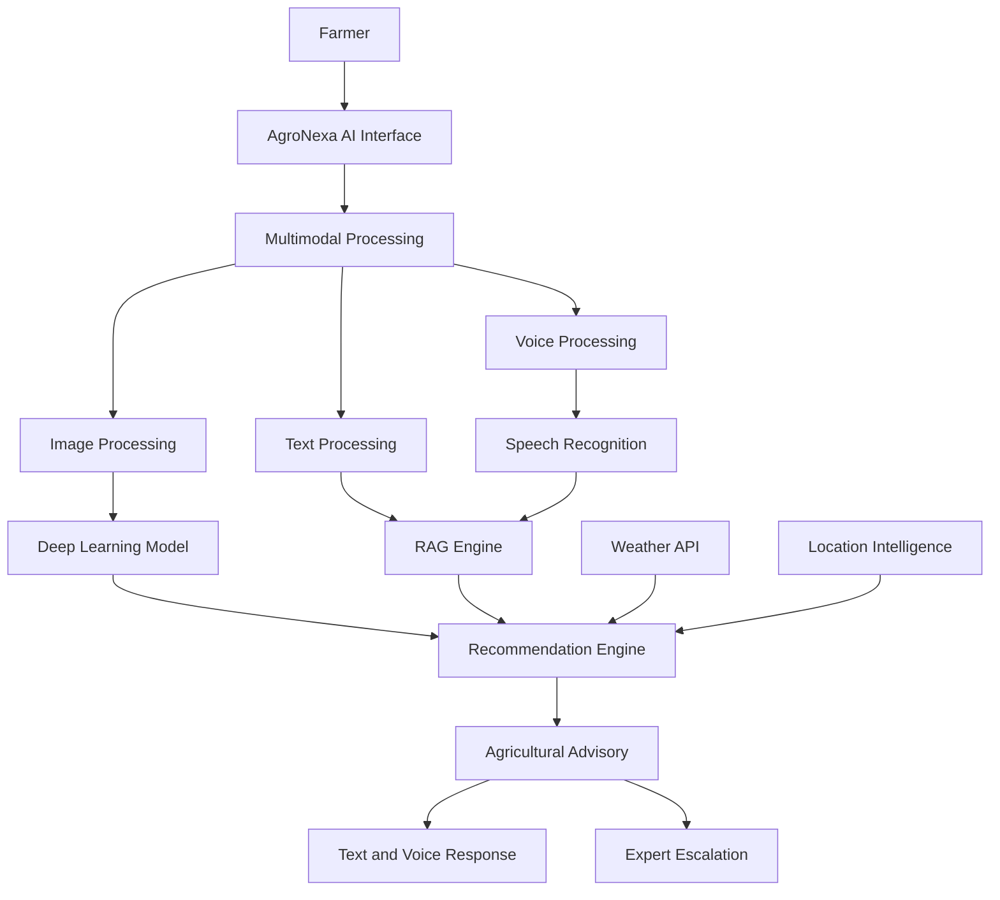
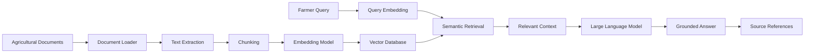

<p align="center">
  
</p>
# 🌱 AgroNexa AI
### Multimodal Crop Diagnostics & RAG-Based Digital Agricultural Advisory System


<div align="center">


**Growing a Smarter Agricultural Future Through Artificial Intelligence.**

</div>

---

## 🌍 About the Project

**AgroNexa AI** is a multimodal AI-powered agricultural advisory platform designed to help farmers make smarter and more informed farming decisions.

It combines Deep Learning, Large Language Models (LLMs), Retrieval-Augmented Generation (RAG), and weather intelligence to provide personalized agricultural assistance.

Farmers can interact through images, text, and voice to identify potential crop diseases, ask agricultural questions, and receive recommendations in supported regional languages.

### 🎯 Our Mission

To make reliable agricultural knowledge and intelligent farming assistance accessible to every farmer.

---

## 🚨 Problem Statement

Farmers face several challenges in modern agriculture:

- Difficulty identifying crop diseases at an early stage.
- Limited access to reliable fertilizer and pesticide information.
- Lack of weather-aware agricultural recommendations.
- Language barriers in accessing agricultural knowledge.
- Limited access to agricultural experts.
- Generic AI answers that may not be supported by verified information.

## 💡 Our Solution

AgroNexa AI aims to address these challenges through a unified agricultural intelligence platform.

The system combines:

1. AI-powered crop disease detection.
2. RAG-based agricultural knowledge retrieval.
3. Multilingual voice and text interaction.
4. Location-based weather intelligence.
5. Personalized agricultural recommendations.
6. Human expert escalation.

---

## ✨ Key Features


### 🌿 1. AI-Based Crop Disease Detection

- Upload crop leaf images for disease identification.
- Deep learning-based image classification.
- Prediction confidence scores.
- Disease prevention and treatment information.
- Support for additional crops and diseases as datasets expand.

**Proposed models:**
- ResNet50
- MobileNetV2
- EfficientNet
- Custom CNN

### 🤖 2. RAG-Based Agricultural Chatbot

An intelligent agricultural assistant that answers farming-related questions using verified knowledge sources.

- Context-aware question answering.
- Agricultural document retrieval.
- Semantic search using embeddings.
- Vector database integration.
- LLM-powered response generation.
- Source-backed answers.

**RAG Pipeline:**

Documents → Text Extraction → Chunking → Embeddings → Vector Database → Retrieval → LLM → Response

### 🎙️ 3. Multimodal Interaction

Farmers can communicate using:

| Input | Function |
|---|---|
| 📝 Text | Agricultural questions |
| 🎙️ Voice | Spoken farming queries |
| 📸 Image | Crop disease diagnosis |

Additional capabilities:
- Speech-to-text.
- Text-to-speech.
- Regional language support.
- Hands-free interaction.

### 🌦️ 4. Weather Intelligence

Weather information can help farmers make better agricultural decisions.

Parameters:
- Temperature.
- Humidity.
- Rainfall probability.
- Wind speed.
- Weather forecasts.

Applications:
- Weather-aware spraying advisories.
- Rainfall-based recommendations.
- Location-specific farming guidance.

All chemical application guidance must follow approved product labels and local agricultural regulations.

### 👨‍🌾 5. Expert Escalation

- Identify complex or low-confidence queries.
- Forward unresolved cases to agricultural experts.
- Maintain query history.
- Support expert-reviewed recommendations.

---

## 🏗️ System Architecture



---

## 🔄 How It Works

1. Farmer opens the application.
2. Farmer submits a question through text, voice, or image.
3. The system identifies the input type.
4. Crop images are processed by the disease detection model.
5. Agricultural questions are processed through the RAG pipeline.
6. Weather and location information are retrieved when relevant.
7. The recommendation engine generates an appropriate response.
8. The farmer receives assistance in a supported language.
9. Complex queries can be forwarded to agricultural experts.

---

## 🧠 RAG Architecture



### Potential Knowledge Sources

- Indian Council of Agricultural Research (ICAR).
- State Agricultural Universities.
- Government agricultural advisories.
- Verified crop disease management guidelines.
- Agricultural research publications.

---

## 🛠️ Technology Stack

### Frontend


### Backend


### AI and Machine Learning


### Generative AI and RAG


### Database and Deployment


*The technology stack represents the proposed implementation choices and may change during development.*

---

## 📁 Project Structure

```text
AgroNexa-AI/
│
├── frontend/
│   ├── src/
│   │   ├── components/
│   │   ├── pages/
│   │   └── services/
│   └── package.json
│
├── backend/
│   ├── routes/
│   ├── services/
│   ├── models/
│   └── main.py
│
├── ai_models/
│   ├── disease_detection/
│   ├── training/
│   └── evaluation/
│
├── rag_engine/
│   ├── document_loader/
│   ├── embeddings/
│   ├── retrieval/
│   └── vector_store/
│
├── datasets/
├── notebooks/
├── screenshots/
├── assets/
├── docs/
├── tests/
│
├── .env.example
├── .gitignore
└── README.md
```

*This is the proposed structure; directories and files will be added as development progresses.*

---

## 📊 Model Evaluation

The crop disease detection component will be evaluated using:

| Metric | Purpose |
|---|---|
| Accuracy | Overall prediction correctness |
| Precision | Correct positive predictions |
| Recall | Identification of positive cases |
| F1-Score | Balance between precision and recall |
| Confusion Matrix | Class-wise performance |
| Inference Time | Prediction speed |

### Proposed Model Comparison

- Custom CNN
- ResNet50
- MobileNetV2
- EfficientNet

The final model will be selected using experimental performance, generalization, and computational efficiency.

---

## 📚 Potential Datasets

| Dataset | Application |
|---|---|
| PlantVillage | Crop disease classification |
| PlantDoc | Real-world plant disease detection |
| Custom field images | Real-world validation |

The project aims to evaluate generalization beyond controlled laboratory images.

---

## 🎯 Expected Outcomes

1. Multimodal agricultural assistant.
2. AI-based crop disease detection.
3. RAG-based agricultural knowledge engine.
4. Weather-aware agricultural recommendations.
5. Regional language accessibility.
6. Expert escalation mechanism.

---

## 🚀 Future Scope

- IoT-based soil health monitoring.
- Satellite-based crop monitoring.
- Crop yield prediction.
- Smart fertilizer optimization.
- Offline-first mobile application.
- Additional Indian regional languages.
- Integration with government agricultural services.

---

## 🔐 Responsible AI

AgroNexa AI is designed as an agricultural decision-support platform, not a replacement for qualified agricultural experts.

- Use verified agricultural information.
- Display prediction uncertainty.
- Escalate low-confidence cases.
- Follow approved pesticide and fertilizer guidelines.
- Protect user images and location data.
- Provide supporting references for RAG-generated answers.

---

## 🤝 Contributing

Contributions are welcome!

1. Fork this repository.
2. Create a feature branch.
3. Implement your changes.
4. Test your implementation.
5. Submit a pull request.

```bash
git checkout -b feature/your-feature-name
git add .
git commit -m "Add: describe your feature"
git push origin feature/your-feature-name
```

---

## 📌 Project Information

| Field | Details |
|---|---|
| Project Name | AgroNexa AI |
| Source | Smart India Hackathon 2025 |
| Problem Statement ID | SIH25076 |
| Domain | Agriculture and Artificial Intelligence |
| Project Category | Multimodal AI / Generative AI |
| Status | In Development |

---

## 👨‍💻 Development Team

**AgroNexa AI Development Team**

Building intelligent agricultural solutions through Artificial Intelligence, Deep Learning, and Generative AI.

---

<div align="center">

### 🌱 Technology for Farmers. Intelligence for Agriculture.

**AgroNexa AI — Growing a Smarter Agricultural Future.**


</div>
